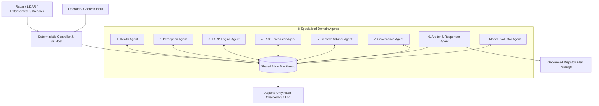

# RockWatch: Multi-Agent Geotechnical Early Warning Platform

## 1. System Architecture & Rationale

RockWatch is a safety-critical multi-agent system for open-pit mine slope stability monitoring. Open-pit rockfalls cannot be reliably forecasted to the exact minute by black-box predictors. Real-world mine safety depends on **Trigger Action Response Plans (TARPs)**, multimodal sensor redundancy, and human geotechnical authority.

RockWatch implements a **Blackboard with Deterministic Controller** pattern hosted on **Microsoft Semantic Kernel**:
1. **Asymmetric Authority:** Any action that increases caution (sensor degradation, unalarmed detachments, risk spikes) takes effect immediately without human approval. Any action that decreases caution (desensitization due to blast dust) is strictly a proposal requiring authenticated Geotechnical Engineer approval, carries a time-limited auto-expiry, and can never override the mandatory baseline TARP safety floor.
2. **Code Computes, LLMs Explain:** Physics calculations, TARP thresholds, hash chaining, and validation gates are plain Python functions. The LLM handles natural language explanations, operator chats, and SOP context.
3. **Graceful Sensor Degradation:** If primary radar is offline, the system continues monitoring via secondary sensors (extensometers, piezometers, weather) with an automatically widened uncertainty margin and elevated caution.

---

## 2. Agent Roster & Plain Python Tools

Each of the 8 agents is a separate module under `agents/` registered as a Semantic Kernel Plugin calling at least two plain Python functions under `tools/`:

| Agent Module | Primary Role | Plain Python Tool 1 | Plain Python Tool 2 |
|---|---|---|---|
| **1. HealthAgent** (`health_agent.py`) | Telemetry ingestion & health auditing | `ingest_sensor_frame` | `assess_sensor_health` |
| **2. PerceptionAgent** (`perception_agent.py`) | 3-D scan change & unalarmed miss detection | `detect_surface_change` | `find_unalarmed_changes` |
| **3. TARPAgent** (`tarp_agent.py`) | Deterministic TARP rules & kinematic physics | `evaluate_tarp` | `compute_inverse_velocity` |
| **4. ForecasterAgent** (`forecaster_agent.py`) | Calibrated horizon risk & uncertainty quantification | `compute_zone_risk` | `create_provenance_record` |
| **5. AdvisorAgent** (`advisor_agent.py`) | SOP retrieval & incident precedent explanations | `retrieve_sop` | `find_similar_incidents` |
| **6. ArbiterAgent** (`arbiter_agent.py`) | Discrepancy arbitration & alert package generation | `arbitrate_decision` | `build_alert_package` |
| **7. GovernanceAgent** (`governance_agent.py`) | Desensitization proposals & root-cause diagnostics | `process_desensitization_proposal` | `propose_root_cause` |
| **8. EvaluatorAgent** (`evaluator_agent.py`) | Golden set QA & non-inferiority validation gate | `evaluate_model_gate` | `sample_quiet_periods` |

Every agent explicitly reads from and writes to the shared `MineBlackboard`.

---

## 3. Memory & Retrieval Architecture

* **Blackboard State (`blackboard.py`):** Partitioned in-memory state tracking `raw_telemetry`, `sensor_health`, `clean_telemetry`, `surface_changes`, `tarp_status`, `forecast`, `advisor_notes`, `arbitration`, `proposals`, and `golden_pool`. Every write increments the partition version and updates writer metadata.
* **Grounded Local RAG (`docs/`):** Authoritative geotechnical SOPs (`tarp_sop_v1.md`), field guidelines (`geotech_guidelines.md`), and historical cases (`historical_incidents.md`). Passages are tagged with explicit IDs (e.g. `[TARP-SOP-02]`). The Advisor cites these passage IDs directly; if a query falls outside the corpus, it returns `"Information not found in geotechnical documentation."` rather than hallucinating.
* **Append-Only Run Log (`logs/run_log.jsonl`):** Each entry contains an SHA-256 hash linking to the previous entry using canonical JSON (`sort_keys=True`).
  * *Documented Limitation:* Hash chaining reliably detects middle-entry modifications or row deletions. It does not prevent whole-tail truncation or complete re-hashing unless anchored to an external root hash. The system prints the final head hash anchor at the end of runs.

---

## 4. One Honest Failure Handled

* **Failure Scenario: Free-Tier LLM Service Outage or API Rate Limiting.**
* **Impact & Handling:** In consumer AI apps, an LLM outage halts the application. In RockWatch, mine safety paths cannot stall. If the LLM connector encounters a timeout or rate limit, Agents 5 and 6 fall back to deterministic string templates. The underlying TARP evaluation, sensor health audit, risk arbitration, and dispatch alert package continue executing in pure Python with zero downtime.

---

## 5. Verification & Scenarios

The test suite (`tests/test_scenarios.py`) covers:
1. **Scenario 1 (Degraded Sensors):** Radar offline -> health flags degradation -> caution elevated to Yellow per TARP-SOP-05 -> uncertainty margin widens.
2. **Scenario 2 (Missed Event):** Un-alarmed 15 m3 detachment found via scan differencing -> instant caution -> added to pending golden pool -> root-cause diagnosis.
3. **Scenario 3 (False Alarm Proposal & Model Gate):** Operator proposal blocked -> Geotech approved -> auto-expires to baseline via injectable clock -> model gate rejects candidate model dropping safety recall.
4. **Scenario 4 (Log Tamper Detection):** Modifying a middle row in `run_log.jsonl` is caught by hash verification.
5. **Scenario 5 (Grounded RAG):** Grounded SOP citation verified; out-of-corpus query fails closed.
6. **Scenario 6 (LLM Outage Resilience):** Level 4 Red evacuation alert fires deterministically during an LLM outage.
